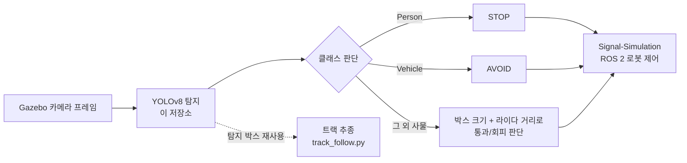
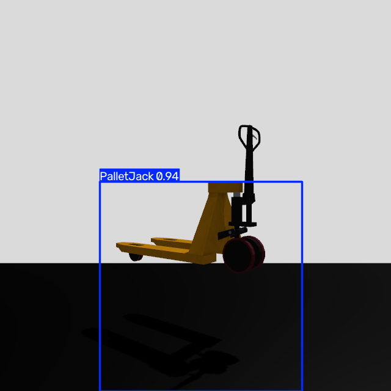
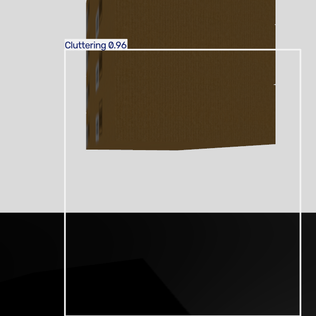
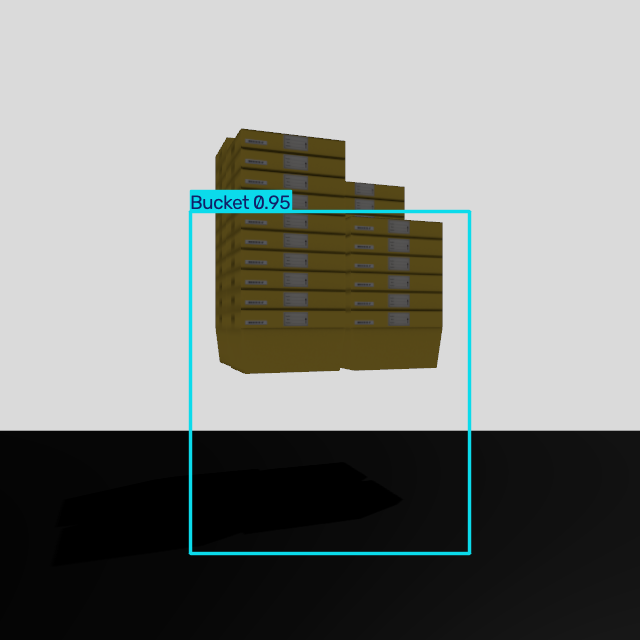
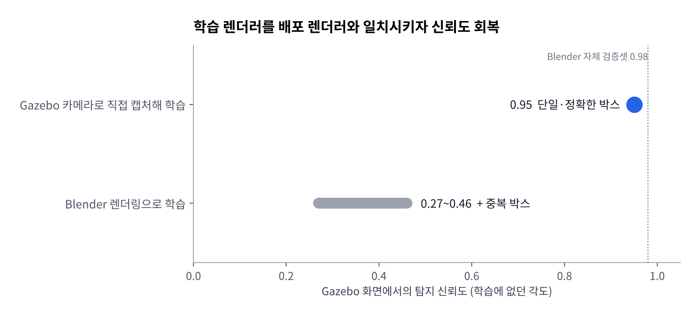
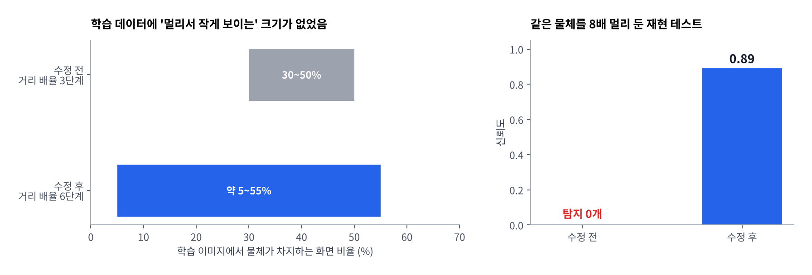
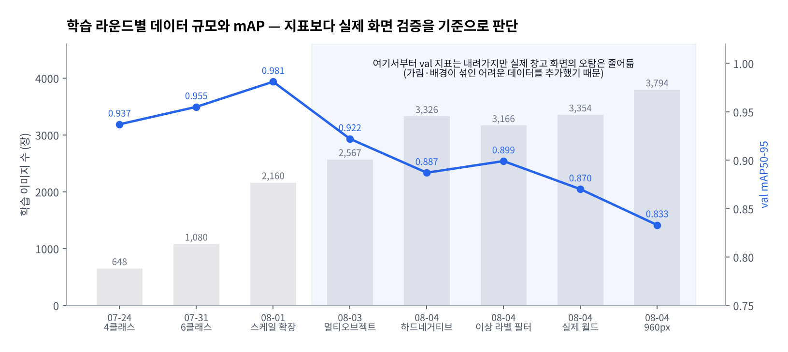

# Signal-transport-perception

**물류 로봇 카메라용 YOLO 장애물 인식 모듈** — 사람·차량·창고 사물을 구분해 로봇이 정지(STOP)할지 회피(AVOID)할지 판단하는 데 쓰는 인지 파트입니다.


> K-NAVI 팀 프로젝트(공정 재해 대비 수신호 인식 + 장애물 감지 로봇 시뮬레이션)의 한 저장소입니다.
> 라이다 충돌 감지와 로봇 모션 제어는 [Signal-Simulation](https://github.com/SAX-AI-TeamProject1/Signal-Simulation), 작업자 수신호 인식은 [Signal-Vision](https://github.com/SAX-AI-TeamProject1/Signal-Vision)이 담당합니다.



---

## 핵심 결과

| 항목 | 결과 |
|---|---|
| 학습 데이터 | Gazebo 렌더러로 **직접 캡처·자동 라벨링한 3,794장** (사람 손 라벨링 0장) |
| 시뮬레이터 화면 신뢰도 | 실사진·Blender 학습본 **0.27~0.46 → 0.95** (도메인 갭 해소) |
| 원거리(8배 축소) 물체 | 탐지 **0개 → 신뢰도 0.89** |
| 여러 물체 동시 인식 | 4개 동시 등장 장면에서 **전부 0.91~0.96**으로 검출 |
| 학습 시간 | 로컬 M4(MPS) 32분 → Kaggle T4 **7분** (640px 기준) |
| 배포 | 다른 저장소에서 `pip install`로 가져다 쓰는 **버전 관리 패키지** (v1.0.7), 가중치는 첫 실행 시 자동 다운로드 |

<table>
  <tr>
    <td></td>
    <td></td>
    <td></td>
  </tr>
  <tr>
    <td colspan="3" align="center"><sub>학습에 없던 각도·거리로 찍은 Gazebo 화면에서의 스팟체크 (PalletJack 0.94 / Cluttering 0.96 / Bucket 0.95)</sub></td>
  </tr>
</table>

---

## 문제 해결 기록

모든 결정의 배경·근거·기각한 대안은 [`docu/decisions.md`](docu/decisions.md)(ADR 14건)에, 날짜별 경과는 [`docu/work.md`](docu/work.md)에 있습니다.

### 1. 실사진으로 학습하면 시뮬레이터 화면을 못 본다 — 도메인 갭 (ADR-007)
- **문제**: COCO·Roboflow 실사진으로 학습한 모델이 Gazebo 화면에서는 신뢰도가 크게 떨어졌고, Blender로 에셋을 렌더링해 학습해도 **0.98 → 0.27~0.46**으로 급락하고 중복 박스가 생김.
- **원인**: 실사진과 비교해 진단한 결과 "클래스가 부족해서"가 아니라 **학습 렌더러(Blender) ≠ 배포 렌더러(Gazebo)** 의 조명·텍스처 차이였음.
- **해결**: 배포 환경과 똑같은 Gazebo 카메라 센서로 학습 이미지를 직접 캡처(`capture_gazebo_dataset.py`). 실제 시뮬레이션 월드는 건드리지 않고 클래스마다 일회용 월드를 생성해 촬영.
- **결과**: 학습에 없던 각도에서도 **단일·정확한 박스, 신뢰도 0.95**.



### 2. 라벨링을 사람 손 없이 — 렌더러가 직접 박스를 계산 (ADR-010)
- **문제**: 메시 치수를 측정해 박스를 삼각함수로 투영하는 방식은 새 클래스마다 수치를 손으로 채워야 했고 손잡이가 잘리는 오차가 있었음.
- **해결**: gz-sim 내장 `boundingbox_camera` 센서로 렌더러가 그린 실루엣에서 바로 박스를 받음. 카메라 거리·높이도 박스 피드백을 보며 자동으로 맞추는 캘리브레이션 루프(`calibrate_target()`)로 대체.
- **결과**: 새 클래스 추가에 필요한 입력이 "어떤 메시를 띄울지" 하나로 줄어듦. 첫 구현의 높이 보정 부호 오류(물체가 하늘로 발산)도 회귀 캡처로 잡아냄.

### 3. 멀리 있는 물체를 전혀 못 잡는다 — 학습 스케일 편향 (ADR-012)
- **문제**: 창고 전체를 내려다보는 화면에서 탐지 실패. 처음엔 "물체가 여러 개라서"로 오판.
- **원인 확인**: 같은 물체 하나를 깨끗한 배경에서 **거리만 8배로 늘려 재현 → 탐지 0개**. 캘리브레이션이 물체를 항상 화면의 30~50% 크기로 맞추고 있어, "멀리서 작게 보이는" 크기가 학습 데이터에 아예 없었음.
- **해결**: 촬영 거리 배율을 3단계에서 6단계로 넓혀 물체 크기를 **화면의 약 5~55%** 로 다양화.
- **결과**: 같은 8배 축소 테스트에서 **신뢰도 0.89**, mAP50-95 0.955 → 0.981.



### 4. 재학습했는데 결과가 소수점까지 똑같다 — 데이터 오염 버그 2건
- **증상**: 데이터를 바꿔 재학습했는데 지표가 이전과 거의 동일. 우연으로 넘기지 않고 학습 로그의 이미지 수를 확인.
- **원인 ①**: 데이터셋 분할 스크립트가 이전 결과를 지우지 않고 계속 덧붙여 **2,160장이어야 할 데이터가 3,328장**으로 누적. → 복사 전에 대상 폴더를 비우도록 수정.
- **원인 ②**: Kaggle은 데이터셋 업로드 "완료" 응답 후에도 서버 처리가 비동기라, 바로 학습을 돌리면 **이전 버전 데이터로 학습**됨. → `kaggle datasets status`로 ready 확인 후 학습하는 절차로 고정.
- **교훈**: 결과가 의심스럽게 같으면 가중치 해시와 로그의 실제 이미지 수부터 확인한다.

### 5. 여러 물체 + 복잡한 배경에서의 오탐 (ADR-013, ADR-014)
- **문제**: 빈 배경·물체 하나로만 학습해서, 실제 창고 화면에서는 기둥·콘솔·선반을 사람이나 차량으로 오탐.
- **해결**:
  - 물체 2~4개 + 라벨 없는 배경 소품을 함께 배치한 **멀티오브젝트 씬** 캡처 추가
  - 실제 주행 월드를 띄운 채 트랙 경로를 따라 카메라를 이동시키며 캡처, 배경만 찍힌 프레임은 **하드 네거티브**로 학습에 포함
  - 걷는 사람(actor)의 위치를 시뮬레이터가 알려주지 않아, 월드 파일의 궤적 웨이포인트를 읽어 **gz-sim과 같은 보간 로직을 외부에서 재구현**해 라벨 계산
  - 렌더러가 투영에 실패하면 화면 전체 크기 박스를 내놓는 라벨 버그를 발견(서로 다른 장면에서 완전히 같은 좌표가 반복), 면적 95% 초과 라벨이 섞인 이미지는 학습에서 제외
- **결과**: 기둥·기계를 사람으로 잡던 오탐 해소, 원거리 사람 다수 신규 검출, 기존 정탐 유지.

### 학습 라운드 전체 흐름



어려운 장면(가림, 복잡한 배경, 원거리)을 추가할수록 val mAP는 내려갔습니다. 그래도 매 라운드를 **실제 창고 스크린샷 재검증**으로 판단했고, 그 기준으로는 오탐이 계속 줄었습니다. 쉬운 검증셋에서 높은 숫자를 지키는 것보다 배포 화면에서 틀리지 않는 쪽을 택했습니다.

---

## 클래스와 행동 판단

| 클래스 | 행동 | 비고 |
|---|---|---|
| `Person` | **STOP** | 라이다 감지 거리 안으로 들어오면 트리거 |
| `Vehicle` (지게차 등) | **AVOID** | 라이다 감지 거리 기준 |
| `PalletJack`, `Bucket`, `Cluttering`, `TrashCan` | 크기 기반 판단 | 박스 크기 + 라이다 거리로 실제 크기 추정 |

- 무게는 어떤 센서로도 측정할 수 없어 클래스별 가정으로 대체합니다 (ADR-004).
- `Cluttering`은 서로 다른 메시 3종을 하나의 의미 클래스로 묶었습니다. 에셋 파일명 같은 구현 디테일이 클래스 체계로 새어 나오지 않게 하기 위함입니다 (ADR-008).

---

## 사용법

### 다른 저장소에서 가져다 쓰기

```bash
pip install "git+https://github.com/SAX-AI-TeamProject1/Signal-transport-perception.git@v1.0.7"
```

가중치(`best.pt`)는 git에 올리지 않습니다. `weights.resolve_weights()`가 아래 순서로 찾고, 없으면 Kaggle에서 자동으로 받아 캐시에 둡니다 (Kaggle CLI 인증 필요).

1. `data/runs/train-kaggle/weights/best.pt` (이 저장소 루트에서 실행할 때)
2. `~/.cache/signal-transport-perception/weights/best.pt` (환경변수 `SIGNAL_PERCEPTION_CACHE`로 변경 가능)
3. Kaggle 커널 `heojaeseong/yolo-percep`의 최신 결과물

### 이 저장소에서 바로 실행

```bash
python3.12 -m venv .venv
.venv/bin/pip install -r requirements.txt

.venv/bin/python tools/fetch_model.py               # 학습된 가중치만 받아오기
.venv/bin/python src/test_gui.py                    # 이미지 골라 추론해 보는 GUI
.venv/bin/python src/validate_new_model.py <best.pt> # test_picture/ 스크린샷으로 오탐 회귀 확인
```

> 현재 가중치는 960px로 학습했습니다. 추론도 `imgsz=960`으로 맞춰야 학습 조건과 일치합니다 (아래 "남은 과제" 참고).

### 데이터 캡처부터 다시 학습하기

VS Code에서 `Terminal → Run Task`의 번호 순서대로 실행하면 됩니다.

| 단계 | 명령 | 하는 일 |
|---|---|---|
| 1. 캡처 | `.venv-gz/bin/python src/capture_gazebo_dataset.py` | 단일 물체 스윕 + 멀티오브젝트 씬 캡처, 자동 라벨링 |
| 1-2. 실제 월드 캡처 | `.venv-gz/bin/python src/capture_navi_factory_dataset.py` | 주행 트랙을 따라 실제 월드 촬영 (`Signal-Simulation`이 옆 폴더에 있어야 함) |
| 2. 분할·업로드 | `.venv/bin/python src/prepare_dataset.py` | train/val 8:2 분할, 이상 라벨 필터링, Kaggle Dataset 업로드 (`--skip-upload`로 생략) |
| 3. 학습 | `bash tools/train_kaggle.sh` | Kaggle T4 GPU 학습 → 완료 대기 → 가중치 회수 |

- `.venv-gz`는 Gazebo 파이썬 바인딩을 쓰기 위해 `--system-site-packages`로 만든 별도 환경입니다.
- `src/train.py`(로컬 MPS)는 코드 변경을 1~2 epoch로 빠르게 확인할 때만 씁니다 (ADR-009).

---

## 구조

```
src/
├── capture_gazebo_dataset.py        Gazebo 캡처 + boundingbox_camera 자동 라벨링 + 캘리브레이션
├── capture_navi_factory_dataset.py  실제 주행 월드 트랙 캡처, actor 궤적 보간, 하드 네거티브
├── prepare_dataset.py               분할, 이상 라벨 필터, Kaggle 업로드
├── train.py                         로컬 스모크 학습
├── infer.py / weights.py            추론 API, 가중치 탐색·자동 다운로드
├── track_follow.py                  HSV 기반 바닥 트랙 인식 (오프셋·곡률), YOLO 박스로 가림 마스킹
├── test_gui.py                      추론 확인용 GUI
└── validate_new_model.py            새 가중치 오탐 회귀 검증
kaggle/yolo-percep/                  Kaggle 학습 노트북
tools/                               학습 트리거·가중치 회수 스크립트
docu/
├── decisions.md                     설계 결정 기록 (ADR-001 ~ 014)
├── work.md                          날짜별 작업 기록
├── yolo-perception-integration-guide.md   Signal-Simulation 연동 명세 (장애물)
└── track-follow-integration-guide.md      Signal-Simulation 연동 명세 (트랙 추종)
```

---

## 남은 과제

- `PalletJack` 신뢰도 편차가 큼 — 얇게 튀어나온 손잡이·포크 형태 때문으로 추정, 각도 다양화 재캡처 검토
- `infer.py`가 아직 기본값 640px로 추론 — 모델 메타데이터에서 학습 해상도를 읽어오도록 정리 필요
- 크기 기반 판단의 임계값, 애매할 때 회피로 떨어뜨리는 fail-safe는 미확정 (ADR-004)
- ROS 2 출력 토픽·메시지 형식은 팀 전체 인터페이스 확정 후 연결 (ADR-005)
- 트랙 추종은 정적 캡처·합성 이미지로만 검증, 시뮬레이션 라이브 연동은 미완 (ADR-011)
